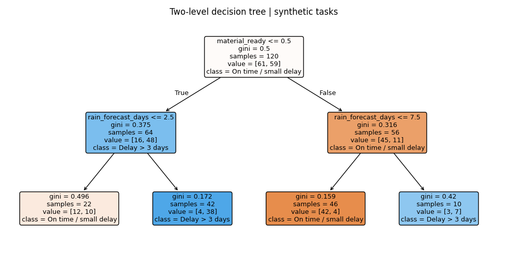

# Schedule Delay Analysis with a Small Decision Tree

**Beginner/intermediate educational project | Synthetic data | AI-assisted implementation**

## Question
Flag tasks at risk of finishing more than three days late using a small, readable decision tree.

## Start here
Open [walkthrough.ipynb](walkthrough.ipynb): short Python cells with explanations in English and Russian, saved outputs and a chart. The entire analysis is also visible in [project.py](project.py), approximately 30 non-comment lines. No custom classes, pipelines or random forests.

## Run
Python 3.11 or newer; preferably a virtual environment. From this project folder:
```bash
python -m pip install -r requirements.txt
python project.py
```
Jupyter is optional and installed separately. The checked-in CSV is ready to read. To regenerate it, run `python generate_data.py` from this folder.

## Data dictionary and assumptions
material_ready: 0/1 at kickoff. rain_forecast_days: forecast rain days in the planning window. crew_size: assigned workers. Target: actual_days minus planned_days exceeds 3; planned and actual durations are in days.

There are 160 independent examples, one per fictional project/task/conveyor. No repeated entities or overlapping outcome windows. Values are complete, so imputation is unnecessary. The generator's fixed formulas and random noise are visible in `generate_data.py`; these are teaching assumptions, not calibrated engineering laws. No real company data are used. Descriptive summaries use historical outcomes; predictors exclude those outcomes. Model settings are fixed in advance and not chosen by trying alternatives on the test set. The 25% holdout is small; no confidence intervals, cross-validation or probability calibration are claimed.

## Saved results
```json
{
  "accuracy": 0.75,
  "baseline_accuracy": 0.5,
  "precision": 0.8571428571428571,
  "recall": 0.6,
  "synthetic_only": true,
  "train_rows": 120,
  "test_rows": 40
}
```


`results/summary.txt` contains the printed analysis; `results/test_predictions.csv` contains held-out predictions. These metrics describe only synthetic examples. The simple baseline helps assess whether the model adds value within this exercise; it does not demonstrate commercial savings.

## Interview and next step
Explain the input columns, target, train/test split, model and baseline before presenting the work. AI assisted code preparation; do not claim independent implementation or professional deployment. Practise changing one small input and explaining the output. Real adoption would require approved historical data, forward-time evaluation, engineering/planning review and monitoring.
